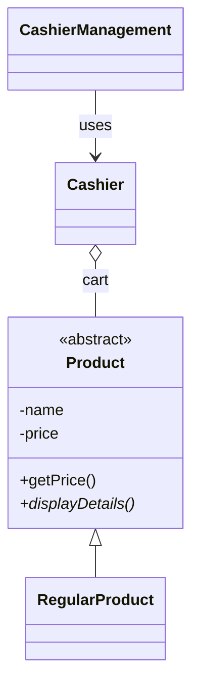

# 🛒 Cashier CLI

A command-line cashier application in Java that demonstrates the core pillars of object-oriented programming: **encapsulation, inheritance, and polymorphism**.

 

## Features

- Menu-driven interface to manage products (add, remove) and process purchases.
- Abstract `Product` base class with a `RegularProduct` subclass, so new product types can be added without changing checkout logic.
- `Cashier` class encapsulates the cart and total calculation.

## Design



## Project structure

```
cashierProject/
└── src/cashierproject/CashierManagement.java   # Product, RegularProduct, Cashier, main menu
```

## Run it

```bash
cd cashierProject/src
javac cashierproject/CashierManagement.java
java cashierproject.CashierManagement
```

Or open `cashierProject` in NetBeans and press **Run**.

## Context

Final exam project for the Object-Oriented Programming lab (2023). Requirements: a CLI program applying all three OOP pillars.

## Future improvements

- Split classes into separate files and add discount/member product types.
- Persist products to a file or SQLite database.
- Add JUnit tests for total and change calculations.
